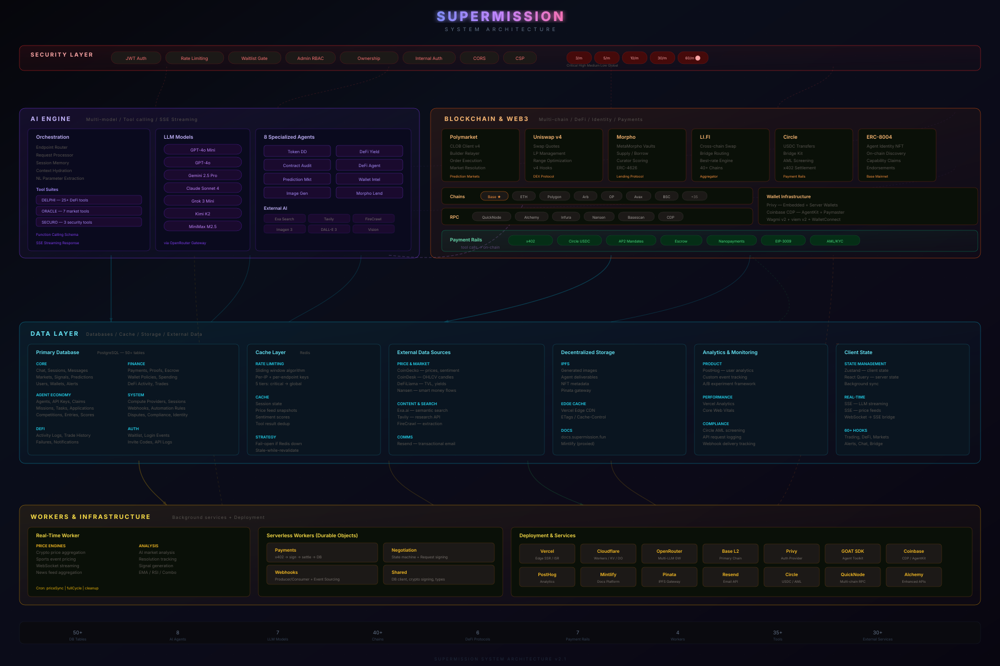

# Supermission Backend Architecture

## System Overview

| Metric | Count |
|--------|-------|
| API Routes | 156 |
| Database Tables | 50+ |
| AI Agents | 8 Specialized |
| LLM Models | 7 (via OpenRouter) |
| Supported Chains | 40+ via LI.FI (main chains: Base, Robinhood Chain, Polygon) |
| Background Workers | 3 Cloudflare + 1 Node.js |
| DeFi Protocols | 6 (Polymarket, Uniswap, Morpho, LI.FI, Circle, ERC-8004) |
| Payment Rails | 5 (x402, Circle USDC, AP2 Mandates, Escrow, Nanopayments) |
| External Services | 30+ |

## Architecture Layers

### 1. Security & Middleware
Every request passes through: Privy JWT verification, Upstash sliding-window rate limiting (5 tiers: 3→60 req/min), waitlist enforcement (requires auth + server-set cookie), admin RBAC, HTTP method validation, resource ownership checks, internal service auth, CORS, and CSP headers.

### 2. API Gateway (156 Routes)
30+ route domains: auth, markets/trading, DeFi, dashboard, chat/agents, agent economy (40+ routes for missions, compute, disputes), payment protocols (x402, Circle, AP2 mandates), and admin. All AI agent endpoints (`/api/new-agents/*`) require authentication via privy-token cookie or x-internal-secret header.

### 3. AI / LLM Engine
Multi-model orchestration via OpenRouter — 7 models (GPT-4o, Gemini 2.5 Pro, Claude Sonnet 4, Grok 3 Mini, Kimi K2, MiniMax M2.5). 8 specialized agents with 35+ tools using OpenAI function-calling schema. SSE streaming for real-time responses. Three tool suites: DELPHI (DeFi analysis), ORACLE (prediction markets), SECURO (contract security). External AI: Exa Search, Tavily, FireCrawl, Google Imagen 3.

### 4. Blockchain & Web3
Multi-chain: **Base** (default/wallet home, chain 8453), **Robinhood Chain** (Arbitrum Nitro L2, chain 4663, USDG stablecoin), and **Polygon** (chain 137, Polymarket) are the main chains, with **Arbitrum** and **Ethereum** also supported and 40+ more reachable via the LI.FI aggregator. Protocol integrations: Polymarket (CLOB prediction markets on Polygon), Uniswap v4 (DEX + LP), Morpho (MetaMorpho lending), Circle (USDC payments + CCTP bridging), ERC-8004 (agent identity NFTs on Base mainnet), Robinhood Agentic Trading (stocks/options via the RORO agent), GOAT SDK (agent toolkit). RPC via QuickNode, Alchemy, Infura, Nansen. Wallets via Privy embedded/server wallets and Coinbase CDP AgentKit.

### 5. Data & Persistence
Supabase PostgreSQL (50+ tables across chat, markets, agents, collaborate, compete, compute, payments, disputes, DeFi, identity). Upstash Redis for sliding-window rate limiting and caching. Pinata/IPFS for decentralized storage. External data from CoinGecko, CoinDesk, DeFiLlama, Nansen.

### 6. Workers & Background
Node.js worker for real-time price engines (crypto + sports), WebSocket price feeds, market analysis, signal generation (EMA crossover, RSI), and cron jobs. Three Cloudflare Workers with Durable Objects: payments (x402 settlement on Base), webhooks (event sourcing), and multi-agent negotiation (state machine). Infrastructure: Vercel Edge, Cloudflare, Supabase Cloud, Upstash, OpenRouter, Base L2, Privy, Mintlify docs.
